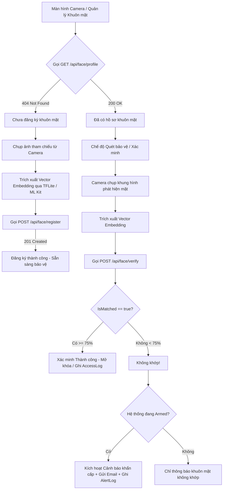

# TÀI LIỆU TÍCH HỢP API FRONTEND (FLUTTER / WEB / MOBILE)
## MODULE CAMERA & NHẬN DIỆN KHUÔN MẶT — DỰ ÁN ANTITHEFT

> **Phiên bản API:** 1.0.0  
> **Backend Framework:** ASP.NET Core 8.0 Web API  
> **Kiến trúc:** RESTful API, JWT Bearer Authentication, On-Device AI Vector Verification  
> **Dành cho:** Frontend Developer, Flutter Developer, Mobile App Integration  

---

## 1. THÔNG TIN MÔI TRƯỜNG & KẾT NỐI

### 1.1. Base URL
- **Máy thật / Thiết bị qua mạng LAN:** `http://<IP_MAY_TINH_BACKEND>:5223` (Ví dụ: `http://192.168.1.15:5223`)
- **Android Emulator (Máy ảo Android Studio mặc định):** `http://10.0.2.2:5223`
- **iOS Simulator:** `http://localhost:5223`
- **HTTPS Port (nếu dùng SSL):** `https://<IP_MAY_TINH_BACKEND>:7203`

### 1.2. Cơ Chế Xác Thực (Authentication)
Tất cả các API khuôn mặt đều được bảo vệ bằng JWT. Frontend **bắt buộc** phải đính kèm header `Authorization` trong mọi request:

```http
Authorization: Bearer <access_token>
```

> **Lưu ý bảo mật quan trọng:**
> - `UserId` được Backend tự động giải mã từ Token (`sub` / `NameIdentifier`).
> - Frontend **KHÔNG** gửi `userId` qua URL query hay Body.
> - Mỗi người dùng chỉ có quyền quản lý và xác minh hồ sơ khuôn mặt của chính mình.

---

## 2. QUY TRÌNH NGHIỆP VỤ (BUSINESS WORKFLOWS)



---

## 3. CHI TIẾT CÁC ENDPOINT API

### 3.1. Lấy thông tin hồ sơ khuôn mặt hiện tại

Dùng khi mở app hoặc vào màn hình Cài đặt sinh trắc học để kiểm tra xem tài khoản đã đăng ký khuôn mặt hay chưa.

- **Method:** `GET`
- **Endpoint:** `/api/face/profile`
- **Headers:**
  ```http
  Authorization: Bearer <access_token>
  ```
- **Phản hồi thành công (`200 OK`):**
  ```json
  {
    "success": true,
    "data": {
      "id": 1,
      "userId": "520f5ea2-b49c-40f7-aacf-e5a4f46b3ff7",
      "profileName": "Khuôn mặt chính chủ",
      "imageUrl": "/api/face/image/Uploads/faces/38e07a68894145949d21c7cb7ef1de6a.jpg",
      "hasEmbedding": true,
      "isActive": true,
      "createdAt": "2026-10-22T13:16:25Z"
    }
  }
  ```
- **Phản hồi khi chưa đăng ký (`404 Not Found`):**
  ```json
  {
    "success": false,
    "message": "Chưa có hồ sơ khuôn mặt nào được đăng ký cho tài khoản này."
  }
  ```
- **Mã lỗi thường gặp:**
  - `401 Unauthorized`: Token không hợp lệ hoặc đã hết hạn.

---

### 3.2. Đăng ký hồ sơ khuôn mặt mới

Dùng khi tài khoản chưa có hồ sơ và người dùng thực hiện chụp ảnh khuôn mặt lần đầu.

- **Method:** `POST`
- **Endpoint:** `/api/face/register`
- **Content-Type:** `multipart/form-data`
- **Headers:**
  ```http
  Authorization: Bearer <access_token>
  ```
- **Các trường trong Form Data:**

| Tên Field | Kiểu dữ liệu | Bắt buộc | Mô tả & Ràng buộc |
| :--- | :--- | :---: | :--- |
| `ProfileName` | String | **Có** | Tên hồ sơ đại diện (tối đa 100 ký tự, ví dụ: "Khuôn mặt chủ xe") |
| `FaceImage` | File (Binary) | **Có** | File ảnh chụp rõ mặt. Định dạng: `.jpg`, `.jpeg`, `.png`. Dung lượng $\le$ 5 MB. |
| `EmbeddingJson` | String (JSON Array) | Không | Chuỗi JSON mảng số thực đại diện cho đặc trưng khuôn mặt (ví dụ: `"[0.052, -0.124, 0.985, ...]"`). Khuyên dùng để xác minh tự động chính xác cao. |

- **Phản hồi thành công (`201 Created`):**
  ```json
  {
    "success": true,
    "message": "Đăng ký hồ sơ khuôn mặt thành công.",
    "data": {
      "id": 1,
      "userId": "520f5ea2-b49c-40f7-aacf-e5a4f46b3ff7",
      "profileName": "Khuôn mặt chủ xe",
      "imageUrl": "/api/face/image/Uploads/faces/a1b2c3d4e5f6.jpg",
      "hasEmbedding": true,
      "isActive": true,
      "createdAt": "2026-10-22T13:20:00Z"
    }
  }
  ```
- **Phản hồi lỗi thường gặp:**
  - `400 Bad Request`: Ảnh không đúng định dạng JPEG/PNG, file quá 5MB, hoặc JSON embedding sai cú pháp:
    ```json
    { "success": false, "message": "Nội dung file không đúng định dạng ảnh JPEG hoặc PNG hợp lệ." }
    ```
  - `409 Conflict`: Tài khoản này đã đăng ký rồi (hệ thống chỉ cho phép 1 hồ sơ tham chiếu chính/User):
    ```json
    { "success": false, "message": "Tài khoản của bạn đã có hồ sơ khuôn mặt. Vui lòng sử dụng chức năng Cập nhật nếu muốn thay đổi thông tin." }
    ```

---

### 3.3. Cập nhật hồ sơ khuôn mặt

Dùng khi người dùng muốn đổi tên hồ sơ, chụp lại ảnh mới, cập nhật lại vector đặc trưng, hoặc tạm thời Tắt/Bật hồ sơ.

- **Method:** `PUT`
- **Endpoint:** `/api/face/profile`
- **Content-Type:** `multipart/form-data`
- **Headers:**
  ```http
  Authorization: Bearer <access_token>
  ```
- **Các trường trong Form Data (Tất cả đều là tùy chọn):**

| Tên Field | Kiểu dữ liệu | Bắt buộc | Mô tả |
| :--- | :--- | :---: | :--- |
| `ProfileName` | String | Không | Tên hồ sơ mới (nếu muốn đổi tên) |
| `FaceImage` | File (Binary) | Không | File ảnh mới (ảnh cũ trên server sẽ được xóa tự động) |
| `EmbeddingJson` | String (JSON Array) | Không | Vector đặc trưng mới |
| `IsActive` | Boolean | Không | `true` (Bật hồ sơ) hoặc `false` (Tạm ngưng) |

- **Phản hồi thành công (`200 OK`):**
  ```json
  {
    "success": true,
    "message": "Cập nhật hồ sơ khuôn mặt thành công.",
    "data": {
      "id": 1,
      "userId": "520f5ea2-b49c-40f7-aacf-e5a4f46b3ff7",
      "profileName": "Khuôn mặt chủ xe (Đã đổi)",
      "imageUrl": "/api/face/image/Uploads/faces/new_image_123.jpg",
      "hasEmbedding": true,
      "isActive": true,
      "createdAt": "2026-10-22T13:20:00Z"
    }
  }
  ```
- **Phản hồi khi chưa có hồ sơ (`404 Not Found`):**
  ```json
  {
    "success": false,
    "message": "Không tìm thấy hồ sơ khuôn mặt của tài khoản để cập nhật."
  }
  ```

---

### 3.4. Xóa hồ sơ khuôn mặt

Dùng khi người dùng muốn hủy bỏ dữ liệu sinh trắc học khuôn mặt khỏi hệ thống.

- **Method:** `DELETE`
- **Endpoint:** `/api/face/profile`
- **Headers:**
  ```http
  Authorization: Bearer <access_token>
  ```
- **Phản hồi thành công (`200 OK`):**
  ```json
  {
    "success": true,
    "message": "Đã xóa hồ sơ khuôn mặt thành công."
  }
  ```
- **Phản hồi khi không tồn tại (`404 Not Found`):**
  ```json
  {
    "success": false,
    "message": "Không tìm thấy hồ sơ khuôn mặt của tài khoản để xóa."
  }
  ```

---

### 3.5. Xác minh khuôn mặt từ Camera (1:1 Verification)

Endpoint cốt lõi khi thiết bị bật camera quét người đứng trước máy/xe để đối chiếu với hồ sơ đã lưu.

- **Method:** `POST`
- **Endpoint:** `/api/face/verify`
- **Content-Type:** `multipart/form-data`
- **Headers:**
  ```http
  Authorization: Bearer <access_token>
  ```
- **Các trường trong Form Data:**

| Tên Field | Kiểu dữ liệu | Bắt buộc | Mô tả |
| :--- | :--- | :---: | :--- |
| `CapturedImage` | File (Binary) | Không | Ảnh chụp từ camera tại thời điểm quét (được lưu làm bằng chứng trong AccessLog/AlertLog). |
| `EmbeddingJson` | String (JSON Array) | **Có** | Vector đặc trưng khuôn mặt trích xuất từ khung hình camera hiện tại. |

- **Phản hồi khi KHUÔN MẶT TRÙNG KHỚP (`200 OK`):**
  ```json
  {
    "success": true,
    "data": {
      "isMatched": true,
      "similarity": 0.9582,
      "confidence": 95.82,
      "message": "Xác minh khuôn mặt thành công. Độ khớp: 95.82%.",
      "capturedImageUrl": "/api/face/image/Uploads/captures/camera_snap_789.jpg",
      "verifiedAt": "2026-10-22T13:25:30Z",
      "securityAlertTriggered": false
    }
  }
  ```
  *(Frontend hiển thị: "Nhận diện chính chủ thành công", mở khóa thiết bị).*

- **Phản hồi khi KHUÔN MẶT KHÔNG KHỚP / NGƯỜI LẠ (`200 OK`):**
  ```json
  {
    "success": true,
    "data": {
      "isMatched": false,
      "similarity": 0.1245,
      "confidence": 12.45,
      "message": "Khuôn mặt không khớp với hồ sơ đã đăng ký. Độ khớp: 12.45% (yêu cầu tối thiểu 75%).",
      "capturedImageUrl": "/api/face/image/Uploads/captures/intruder_456.jpg",
      "verifiedAt": "2026-10-22T13:25:35Z",
      "securityAlertTriggered": true
    }
  }
  ```
  > **Đặc biệt lưu ý cờ `securityAlertTriggered`:**
  > - Nếu hệ thống đang bật chế độ bảo vệ (`IsArmed == true`), cờ này sẽ trả về `true`.
  > - Backend đã tự động tạo một `AlertLog` khẩn cấp và gửi email cảnh báo cho chủ tài khoản.
  > - Frontend Mobile nên phát âm thanh còi báo động (Siren) hoặc rung mạnh và hiển thị popup cảnh báo xâm nhập.

- **Phản hồi khi chưa có hồ sơ tham chiếu (`400 Bad Request`):**
  ```json
  {
    "success": false,
    "message": "Tài khoản của bạn chưa đăng ký hồ sơ khuôn mặt để làm dữ liệu đối chiếu xác minh."
  }
  ```

---

### 3.6. Tải và xem ảnh bảo mật

Endpoint phục vụ xem ảnh tham chiếu hoặc ảnh bằng chứng xâm nhập.

- **Method:** `GET`
- **Endpoint:** `/api/face/image/{*relativePath}`
- **Ví dụ gọi:** `GET http://10.0.2.2:5223/api/face/image/Uploads/faces/a1b2c3d4e5f6.jpg`
- **Headers:**
  ```http
  Authorization: Bearer <access_token>
  ```
- **Quy tắc phân quyền:**
  - Nếu là User chủ sở hữu ảnh: Trả về Binary stream của ảnh (`image/jpeg` hoặc `image/png`).
  - Nếu là Admin: Cho phép xem mọi ảnh để phục vụ giám sát hệ thống.
  - Nếu là User khác: Trả về `403 Forbidden` (Ngăn chặn lộ lọt dữ liệu sinh trắc học).
  - Không có token: Trả về `401 Unauthorized`.

---

## 4. CODE MẪU HOÀN CHỈNH DÀNH CHO FLUTTER (DART)

Dưới đây là mã nguồn Dart chuẩn mực, sử dụng thư viện `http` phổ biến của Flutter.

### 4.1. Models (`face_models.dart`)

```dart
class FaceProfile {
  final int id;
  final String userId;
  final String profileName;
  final String? imageUrl;
  final bool hasEmbedding;
  final bool isActive;
  final DateTime createdAt;

  FaceProfile({
    required this.id,
    required this.userId,
    required this.profileName,
    this.imageUrl,
    required this.hasEmbedding,
    required this.isActive,
    required this.createdAt,
  });

  factory FaceProfile.fromJson(Map<String, dynamic> json) {
    return FaceProfile(
      id: json['id'] as int,
      userId: json['userId'] as String,
      profileName: json['profileName'] as String,
      imageUrl: json['imageUrl'] as String?,
      hasEmbedding: json['hasEmbedding'] as bool? ?? false,
      isActive: json['isActive'] as bool? ?? true,
      createdAt: DateTime.parse(json['createdAt'] as String),
    );
  }
}

class FaceVerificationResult {
  final bool isMatched;
  final double similarity;
  final double confidence;
  final String message;
  final String? capturedImageUrl;
  final DateTime verifiedAt;
  final bool securityAlertTriggered;

  FaceVerificationResult({
    required this.isMatched,
    required this.similarity,
    required this.confidence,
    required this.message,
    this.capturedImageUrl,
    required this.verifiedAt,
    required this.securityAlertTriggered,
  });

  factory FaceVerificationResult.fromJson(Map<String, dynamic> json) {
    return FaceVerificationResult(
      isMatched: json['isMatched'] as bool? ?? false,
      similarity: (json['similarity'] as num?)?.toDouble() ?? 0.0,
      confidence: (json['confidence'] as num?)?.toDouble() ?? 0.0,
      message: json['message'] as String? ?? '',
      capturedImageUrl: json['capturedImageUrl'] as String?,
      verifiedAt: DateTime.parse(json['verifiedAt'] as String),
      securityAlertTriggered: json['securityAlertTriggered'] as bool? ?? false,
    );
  }
}
```

---

### 4.2. API Service (`face_api_service.dart`)

```dart
import 'dart:convert';
import 'dart:io';
import 'package:http/http.dart' as http;
import 'face_models.dart';

class FaceApiService {
  // Thay đổi IP theo máy backend của bạn (10.0.2.2 cho Android Emulator)
  static const String baseUrl = 'http://10.0.2.2:5223';

  final String token;

  FaceApiService({required this.token});

  Map<String, String> get _headers => {
        'Authorization': 'Bearer $token',
      };

  /// 1. Lấy hồ sơ khuôn mặt
  Future<FaceProfile?> getProfile() async {
    final response = await http.get(
      Uri.parse('$baseUrl/api/face/profile'),
      headers: _headers,
    );

    if (response.statusCode == 200) {
      final jsonBody = jsonDecode(response.body);
      return FaceProfile.fromJson(jsonBody['data']);
    } else if (response.statusCode == 404) {
      // Chưa đăng ký hồ sơ
      return null;
    } else {
      throw Exception('Lỗi lấy hồ sơ: ${response.statusCode} - ${response.body}');
    }
  }

  /// 2. Đăng ký hồ sơ khuôn mặt mới
  Future<FaceProfile> registerFace({
    required String profileName,
    required File imageFile,
    List<double>? embeddingVector,
  }) async {
    final uri = Uri.parse('$baseUrl/api/face/register');
    final request = http.MultipartRequest('POST', uri)
      ..headers.addAll(_headers)
      ..fields['ProfileName'] = profileName;

    if (embeddingVector != null && embeddingVector.isNotEmpty) {
      request.fields['EmbeddingJson'] = jsonEncode(embeddingVector);
    }

    request.files.add(await http.MultipartFile.fromPath('FaceImage', imageFile.path));

    final streamedResponse = await request.send();
    final response = await http.Response.fromStream(streamedResponse);

    if (response.statusCode == 201) {
      final jsonBody = jsonDecode(response.body);
      return FaceProfile.fromJson(jsonBody['data']);
    } else if (response.statusCode == 409) {
      throw Exception('Tài khoản đã có hồ sơ khuôn mặt.');
    } else {
      final jsonBody = jsonDecode(response.body);
      throw Exception(jsonBody['message'] ?? 'Lỗi đăng ký khuôn mặt.');
    }
  }

  /// 3. Cập nhật hồ sơ khuôn mặt
  Future<FaceProfile> updateProfile({
    String? profileName,
    File? newImageFile,
    List<double>? newEmbeddingVector,
    bool? isActive,
  }) async {
    final uri = Uri.parse('$baseUrl/api/face/profile');
    final request = http.MultipartRequest('PUT', uri)..headers.addAll(_headers);

    if (profileName != null) request.fields['ProfileName'] = profileName;
    if (isActive != null) request.fields['IsActive'] = isActive.toString();
    if (newEmbeddingVector != null) {
      request.fields['EmbeddingJson'] = jsonEncode(newEmbeddingVector);
    }
    if (newImageFile != null) {
      request.files.add(await http.MultipartFile.fromPath('FaceImage', newImageFile.path));
    }

    final streamedResponse = await request.send();
    final response = await http.Response.fromStream(streamedResponse);

    if (response.statusCode == 200) {
      final jsonBody = jsonDecode(response.body);
      return FaceProfile.fromJson(jsonBody['data']);
    } else {
      final jsonBody = jsonDecode(response.body);
      throw Exception(jsonBody['message'] ?? 'Lỗi cập nhật hồ sơ.');
    }
  }

  /// 4. Xóa hồ sơ khuôn mặt
  Future<bool> deleteProfile() async {
    final response = await http.delete(
      Uri.parse('$baseUrl/api/face/profile'),
      headers: _headers,
    );

    if (response.statusCode == 200) {
      return true;
    } else {
      final jsonBody = jsonDecode(response.body);
      throw Exception(jsonBody['message'] ?? 'Lỗi xóa hồ sơ.');
    }
  }

  /// 5. Xác minh khuôn mặt (1:1 Face Verification)
  Future<FaceVerificationResult> verifyFace({
    File? capturedImage,
    required List<double> currentEmbeddingVector,
  }) async {
    final uri = Uri.parse('$baseUrl/api/face/verify');
    final request = http.MultipartRequest('POST', uri)
      ..headers.addAll(_headers)
      ..fields['EmbeddingJson'] = jsonEncode(currentEmbeddingVector);

    if (capturedImage != null) {
      request.files.add(await http.MultipartFile.fromPath('CapturedImage', capturedImage.path));
    }

    final streamedResponse = await request.send();
    final response = await http.Response.fromStream(streamedResponse);

    if (response.statusCode == 200) {
      final jsonBody = jsonDecode(response.body);
      return FaceVerificationResult.fromJson(jsonBody['data']);
    } else {
      final jsonBody = jsonDecode(response.body);
      throw Exception(jsonBody['message'] ?? 'Lỗi xác minh khuôn mặt.');
    }
  }

  /// 6. Tạo URL đầy đủ để hiển thị ảnh khuôn mặt
  String getFullImageUrl(String relativeImageUrl) {
    if (relativeImageUrl.startsWith('http')) return relativeImageUrl;
    return '$baseUrl$relativeImageUrl';
  }
}
```

---

### 4.3. Hiển thị ảnh bảo mật trong Widget Flutter

Vì endpoint ảnh yêu cầu header `Authorization: Bearer <token>`, bạn không thể dùng `Image.network(url)` thông thường mà cần truyền header:

```dart
Widget buildSecureImage(String imageUrl, String token) {
  final fullUrl = 'http://10.0.2.2:5223$imageUrl';
  return Image.network(
    fullUrl,
    headers: {'Authorization': 'Bearer $token'},
    fit: BoxFit.cover,
    loadingBuilder: (context, child, progress) {
      if (progress == null) return child;
      return const Center(child: CircularProgressIndicator());
    },
    errorBuilder: (context, error, stackTrace) {
      return const Icon(Icons.person, size: 64, color: Colors.grey);
    },
  );
}
```

---

## 5. BẢNG MÃ LỖI (HTTP STATUS CODES)

| Mã lỗi | Nguyên nhân | Hướng xử lý ở Frontend |
| :---: | :--- | :--- |
| **`200 OK`** | Thao tác thành công | Cập nhật UI tương ứng. |
| **`201 Created`** | Đăng ký hồ sơ thành công | Chuyển hướng sang màn hình Quản lý hoặc Bật bảo vệ. |
| **`400 Bad Request`** | Sai định dạng ảnh, ảnh rỗng, hoặc vector lỗi | Hiển thị thông báo `message` từ server cho người dùng chụp lại. |
| **`401 Unauthorized`** | Token thiếu, sai, hoặc đã hết hạn | Chuyển hướng người dùng về màn hình Đăng nhập (Login). |
| **`403 Forbidden`** | Cố tình truy cập ảnh của tài khoản khác | Báo lỗi không có quyền truy cập. |
| **`404 Not Found`** | Tài khoản chưa đăng ký hồ sơ khuôn mặt | Hiển thị nút "Đăng ký khuôn mặt ngay". |
| **`409 Conflict`** | Tài khoản đã đăng ký khuôn mặt trước đó | Chuyển sang gọi API Cập nhật (PUT) thay vì Đăng ký mới (POST). |
| **`500 Internal Error`**| Lỗi hệ thống server hoặc SQL | Báo người dùng thử lại sau. |
